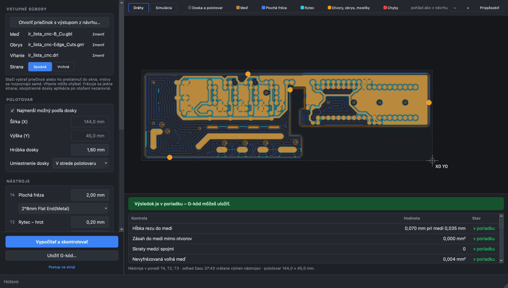
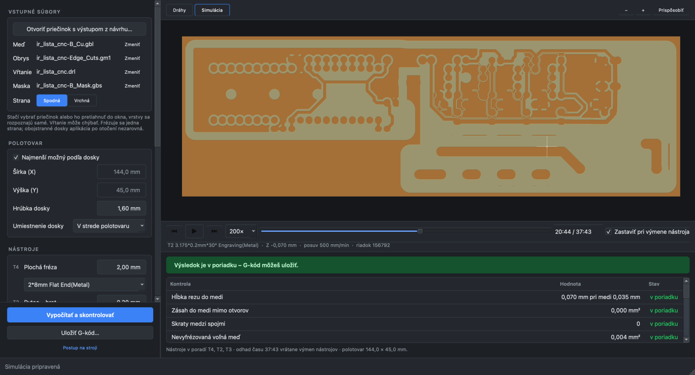

# Z1 PCB

Turns Gerber and Excellon files into G-code for the Makera Z1 (isolation, copper clearing, holes, cutouts,
outline with tabs), checks it geometrically against the design before saving, and plays it in a simulation.
It can also check G-code made by Makera Studio.

One board side per job. Double-sided boards are not supported (no alignment after flipping the board).
The user interface is in Slovak.

- **Input:** a folder of Gerber + Excellon files from any PCB program; layers are recognised by their X2
  attributes or names. Open or foreign outlines are reported with the place of the gap.
- **Tools:** with Makera Studio installed, its tool library is read and picking a tool fills in its size and
  Makera's cutting data. Copper foil 18 / 35 / 70 µm sets the depth of cut.
- **Check:** copper damage, shorts, free copper left, holes, cutouts and outline, and whether the G-code was
  made from the design files now loaded. Works for Makera Studio's G-code too.
- **Simulation:** material removal on the machine's timeline, tool changes, time estimate from the Z1's axis limits.
- **Solder mask:** with the mask Gerber of the milled side, the job is split into two programs: copper first; then,
  after the UV mask is applied and cured on the board left in place, the pads are scraped open with Makera's
  spring-loaded remover, and only then holes, cutouts and outline are cut. How the Z1 measures the spring-loaded
  tool after `M6` is not verified yet.

## Installation (Windows 10/11)

Download `Z1PCB-x.y.z-setup.exe` from the [releases](https://github.com/JoeApo108/z1pcb-releases/releases/latest)
and run it. It installs without admin rights. The installer is not signed with a code-signing certificate, so Windows
shows "Windows protected your PC": click **More info → Run anyway** (Slovak Windows: „Ďalšie informácie → Spustiť
aj tak“). After that the app offers newer versions itself and installs only those signed by the release key.

Not yet verified on the machine: the height map (autoleveling) with G-code from this app. Make the first board a test.

## Notes from reading the Z1 firmware (1.1.3)

- Outside the probed rectangle the Z1 applies no height correction at all (Makera changed Smoothieware's
  clamping, `CartGridStrategy::doCompensation`). Probe the whole stock: the clearing cutter goes past the board edge.
- Don't stop a grid probe halfway; if it stops, power-cycle before probing again
  ([firmware issue #7](https://github.com/MakeraInc/MakeraZ1Firmware/issues/7)).
- Streamed lines go through a 130-byte buffer without a length check and are kept to 63 characters
  (`SerialConsole.cpp`, `Player.h`). This app writes no line longer than 128 characters; commands are under 40.
- The spindle waits a fixed 8 s after `M3` and 4 s after `M5`; all axes accelerate at 150 mm/s². The time estimate
  includes both.

## Running from source

    python3.12 -m venv .venv && source .venv/bin/activate
    pip install --no-deps -r requirements.txt -r requirements-dev.txt
    python -m z1pcb                      # window
    python -m z1pcb tests/data/ir_lista  # window with a folder loaded
    python -m z1pcb.cli make --copper B_Cu.gbl --outline Edge_Cuts.gm1 --drill board.drl -o board.cnc
    python -m z1pcb.cli check --copper … --outline … --drill … --gcode studio.nc

`--no-deps` is deliberate: `gerbonara` declares `click`, `rtree` and `quart`, which the app never imports.
`requirements.txt` is the complete list of what runs.

## Tests and formatting

    python -m pytest -q -n auto   # in parallel, ~1 min; the window is tested without a screen (offscreen)
    ruff format . && ruff check .

## Layout

| Module | Purpose |
|---|---|
| `gerberio` | Gerber/Excellon → geometry; closed-outline check; layer detection |
| `cam` | toolpaths |
| `gcode` | G-code for the Z1; header with version, parameters and hashes of the input files |
| `gparse` | the one G-code reader (moves, timing, arcs), used by the checks and the simulation |
| `checks` | check of a G-code file against the design, verdict |
| `sim` | material height map |
| `job` | "make" and "check a file", shared by the window and the command line |
| `makera_lib` | reads Makera Studio's tool library (read-only), if installed |
| `updates` | updates: only an installer with a valid release signature |
| `gui`, `gui_sim`, `widgets`, `theme`, `canvas` | window |

## Releasing

    tools/release.sh             # clean tree: tests → Windows build and tests on GitHub Actions → signature
    tools/release.sh --dirty     # test build from a work-in-progress tree

The Windows build runs on a GitHub-hosted machine (`.github/workflows/windows.yml`), started by pushing the commit
to a temporary `build/<sha>` branch. `tools/fetch_wheels.sh` downloads the Windows packages through safe-chain and
locks them by hash in `requirements-windows.lock`; the build installs only those (`--require-hashes`).
`tools/collect_licenses.py` puts the license texts of everything shipped into the installer.
The installer is signed with the key `z1pcb-release-signing-key` from `csec` (Touch ID); its public half is in
`z1pcb/updates.py`. Publishing (`gh release create …`) is a manual step; the script prints the command.
Without the `.sig` file the app does not offer a release.

Losing the signing key means installed copies no longer update themselves: a new key and a manual install are needed.

## License

MIT, see [LICENSE](LICENSE). Third-party components and their licenses: [licenses/](licenses/), and in the
installed app *Pomoc → Licencie* (`THIRD-PARTY.txt`).
